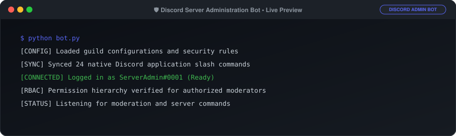
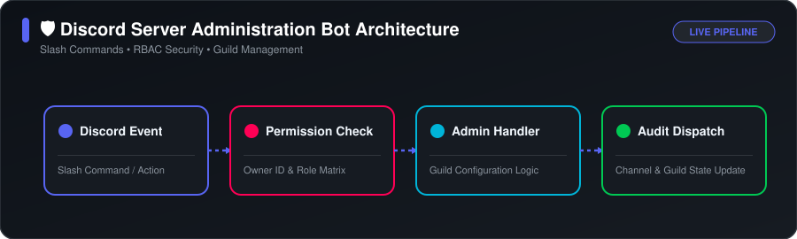

<h1 align="center">🛡️ Discord Server Administration Bot</h1>

<p align="center">
  <a href="https://github.com/itzxsahil">
    
  </a>
</p>

<p align="center">
    
</p>

---

## 📸 Project Preview

<p align="center">
  
</p>

---

# 🚀 Overview

A Discord server administration bot featuring permission-gated slash commands, per-guild customization, and security verification.

---

# 🏗️ System Architecture & Data Flow

<p align="center">
  
</p>

<br>

Discord app commands are received via WebSocket gateway, verified against guild owner IDs and roles in `config.json`, and executed with audit confirmation.

---

# ✨ Features

✅ **Native Slash Commands**: Modern Discord interface support.\n✅ **Role & Owner Security**: Commands strictly protected by Discord role hierarchies.\n✅ **Persistent Guild Settings**: Custom configuration stored per server in `config.json`.

---

# 📦 Installation & Quickstart

```bash
# Configure your token in config.json
pip install -r requirements.txt
python bot.py
```

---

# 👤 Author & Support
- Built with ❤️ by [@itzxsahil](https://github.com/itzxsahil)
- Star ⭐ this repository if you find it helpful!
